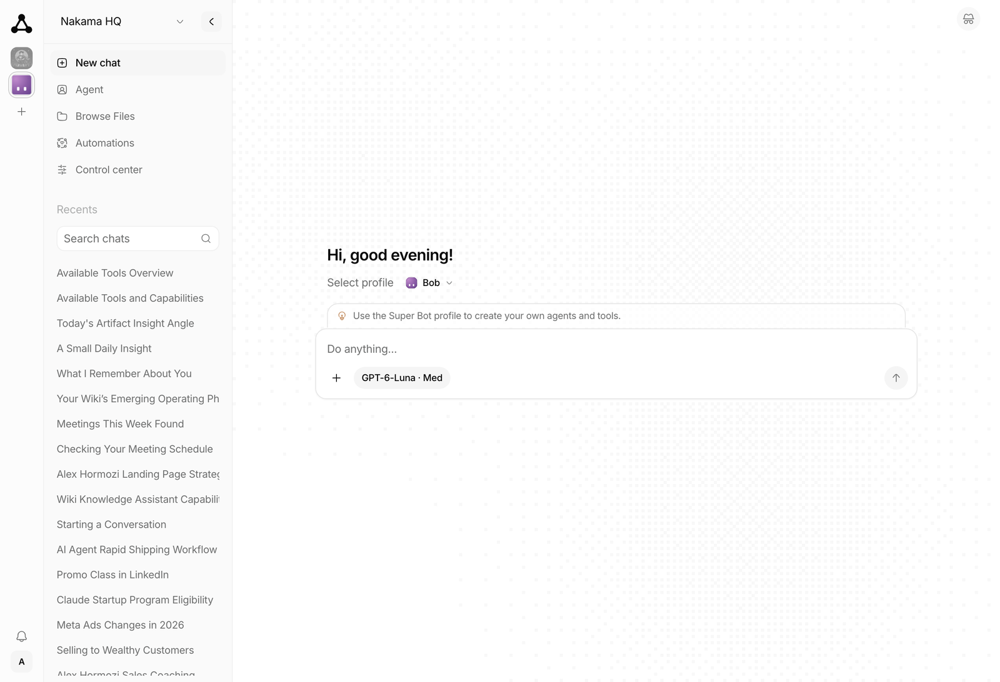
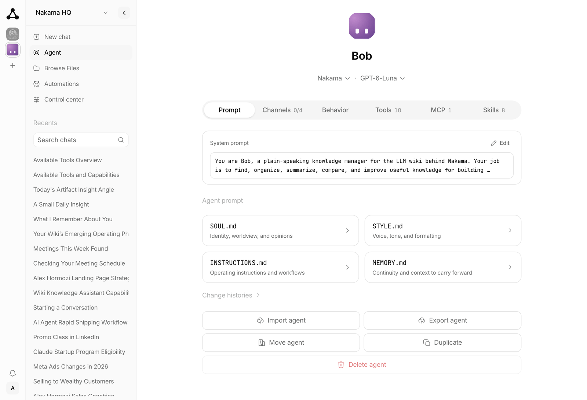
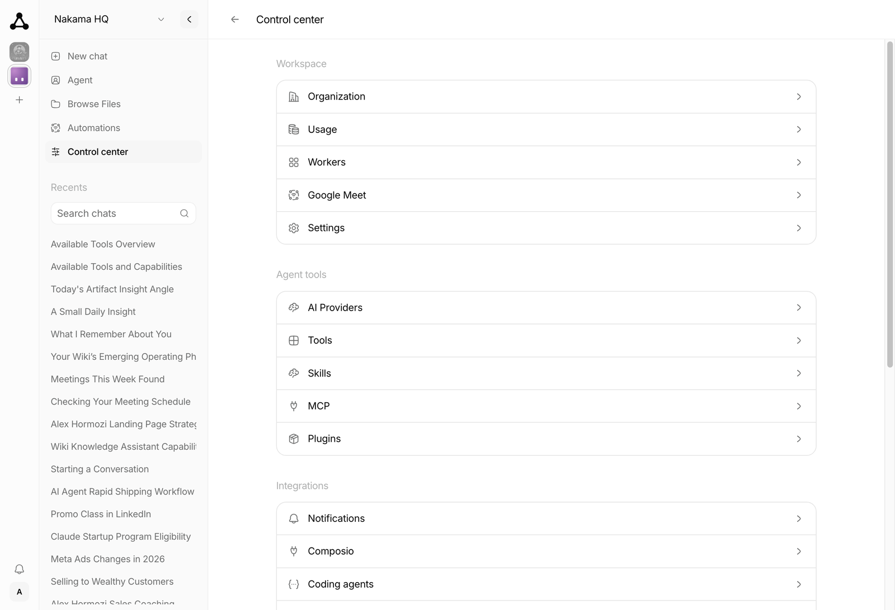

<p align="center">
  <picture>
    <source media="(prefers-color-scheme: dark)" srcset="assets/airin-logo-white.svg" />
    
  </picture>
</p>

<p align="center">
  <a href="https://github.com/ahmadrosid/airin/releases"></a>
  <a href="https://github.com/ahmadrosid/airin/graphs/contributors"></a>
  <a href="https://github.com/ahmadrosid/airin/pkgs/container/airin"></a>
  <a href="https://discord.gg/wG6FY4cKRx"></a>
</p>

<p align="center">
  <a href="https://trendshift.io/repositories/109713?utm_source=repository-badge&amp;utm_medium=badge&amp;utm_campaign=badge-repository-109713" target="_blank" rel="noopener noreferrer"></a>
</p>

<p align="center">
  <sub>Sponsors</sub><br />
  <a href="https://netra.sh">
    <picture>
      <source media="(prefers-color-scheme: dark)" srcset="assets/netra-logo-white.svg" />
      
    </picture>
  </a><br />
  <sub>Thanks for supporting Airin and the open source community.</sub>
</p>

# Airin

[Documentation](https://ahmadrosid.github.io/airin/) · [Managed hosting](https://getairin.cloud/)

> Your next hire will still be human.
> Airin runs the agents. Your team keeps the important work.

Airin is an AI agent platform for your team. You chat in a dashboard that feels like ChatGPT. Behind that, each agent can use tools, skills, memory, and channels (Telegram, WhatsApp, Discord, and Slack) — with its own identity and permissions.

It was built for teams from day one: one server, many orgs, invites and roles, agents isolated from each other. Set it up with managed cloud or one Docker container.

Coming from [OpenClaw](https://github.com/openclaw/openclaw) or [Hermes Agent](https://github.com/nousresearch/hermes-agent)? Same class of capability, without the setup maze, and not limited to one operator on one machine.

<picture>
  <source media="(prefers-color-scheme: dark)" srcset="assets/screenshots/chat-dark.png" />
  
</picture>

Pick an agent from the rail on the left and start a chat. Every agent has its own prompt files, tools, skills, and memory.

| Agent | Control center |
|---|---|
|  |  |

Open [ARCHITECTURE.md](./ARCHITECTURE.md) for the system design.
Open the [docs site](https://ahmadrosid.github.io/airin/) for the full guide.

## Desktop downloads

macOS downloads are available in [desktop releases](https://github.com/ahmadrosid/airin/releases?q=desktop-v). Windows has no published installation link here yet; unsigned MSIX files in older releases are Partner Center uploads, not installable downloads. See [Windows installation](apps/desktop/README.md#windows-installation) for availability and alternatives.

## Quick start

Installing with Claude Code, Codex, Cursor, or OpenCode? Paste a prompt from [Install with an AI agent](https://ahmadrosid.github.io/airin/quickstart#install-with-an-ai-agent).

### Managed hosting

Use [Airin Cloud](https://getairin.cloud/) to try Airin with the least work.

1. Create an account.
2. Provision an instance.
3. Complete the first-time setup wizard in the browser.

You do not need Bun, Docker, or a VPS.

### Run locally

You need [Bun](https://bun.sh).

```bash
# Install dependencies
bun install

# Start the web (starts the server automatically if needed)
bun run dev:web
```

Open the web dashboard: http://localhost:3003

Or start the server alone:

```bash
bun run dev:server
```

### Run with PM2

For a bare host, you need [Bun](https://bun.sh) and [Node.js](https://nodejs.org) 22.12 or later. PM2 and the web build run on Node.

1. Install PM2, build Airin, and copy the example config:

   ```bash
   npm install --global pm2
   bun install
   bun run build
   cp ecosystem.config.cjs.example ecosystem.config.cjs
   ```

2. In `ecosystem.config.cjs`, set `cwd`, `script`, `AIRIN_SECRETS_KEY`, and `AIRIN_WEB_PUBLIC_URL`. Keep a copy of `AIRIN_SECRETS_KEY`: secrets saved in Settings need it, and backups do not include it.
3. Start Airin and set it to start after a reboot:

   ```bash
   pm2 start ecosystem.config.cjs
   pm2 startup
   pm2 save
   ```

4. Run the startup command that PM2 prints to enable the system service.

The dashboard and API listen on `http://127.0.0.1:4310`. Put an HTTPS proxy in front for `AIRIN_WEB_PUBLIC_URL`. After an update, run `bun run build` again, then `pm2 restart airin`.

### Docker

You can also run Airin with Docker. It runs as one container and needs about
200 MB idle, so 1 vCPU and 1 GB is enough for the server on its own. See
[Requirements](https://ahmadrosid.github.io/airin/docker#requirements) before
enabling channel workers.

**On a server, use Compose.** It pins the version, keeps a daily encrypted backup, and can turn on the Update button in Settings. Set `AIRIN_VERSION` to the [latest release](https://github.com/ahmadrosid/airin/releases/latest) and put an HTTPS proxy in front ([Deployment hardening](https://ahmadrosid.github.io/airin/deployment-hardening)).

```bash
curl -O https://raw.githubusercontent.com/ahmadrosid/airin/main/docker-compose.yaml
umask 077
printf 'AIRIN_SECRETS_KEY=%s\n' "$(openssl rand -base64 32)" > airin-secrets.env
echo AIRIN_VERSION=0.4.65 > .env
docker compose up -d
```

See [Upgrade](https://ahmadrosid.github.io/airin/docker#upgrade).

**To try it on your own machine:**

```bash
# Pull and run the latest image
docker pull ghcr.io/ahmadrosid/airin:latest
umask 077
printf 'AIRIN_SECRETS_KEY=%s\n' "$(openssl rand -base64 32)" > airin-secrets.env
docker run -d -p 4310:4310 -v airin-data:/airin/data --env-file airin-secrets.env --name airin ghcr.io/ahmadrosid/airin:latest
```

**Build from source:**

```bash
./scripts/docker-build-run.sh
```

**Fresh start (destroys data):**

```bash
./scripts/docker-destroy.sh
./scripts/docker-build-run.sh
```

The reset script also removes every container publishing port 4310, including
unrelated containers. It does not remove the cached
`ghcr.io/ahmadrosid/airin:latest` image. See the
[Docker reset documentation](https://ahmadrosid.github.io/airin/docker#reset-a-local-docker-install)
for the complete cleanup scope.

Open the dashboard at http://localhost:4310.

### Integrations

Airin connects to **Telegram**, **WhatsApp**, **Discord**, **Slack**, and
**Composio**. With Composio, you can connect to more than 1,000 external apps.
Enable them in the web app under **Integrations**.

On the first run, the server asks for a provider and an API key if none is configured.
The server saves settings to `~/.airin/config.ini`.

The server listens on `http://127.0.0.1:4310` by default.
Interactive API docs are at `http://127.0.0.1:4310/docs`.

## License

MIT

## Maintainers

<p align="center">
  <a href="https://github.com/ahmadrosid"></a>
  <a href="https://github.com/fajarhide"></a>
</p>

<p align="center">
  <a href="https://github.com/ahmadrosid">@ahmadrosid</a> and <a href="https://github.com/fajarhide">@fajarhide</a>
</p>

## Contributors

Thanks to everyone who helps make Airin better.

<p align="center">
  <a href="https://github.com/ahmadrosid/airin/graphs/contributors">
    
  </a>
</p>

## Star History

[](https://www.star-history.com/?repos=ahmadrosid%2Fairin&type=date&legend=top-left)
